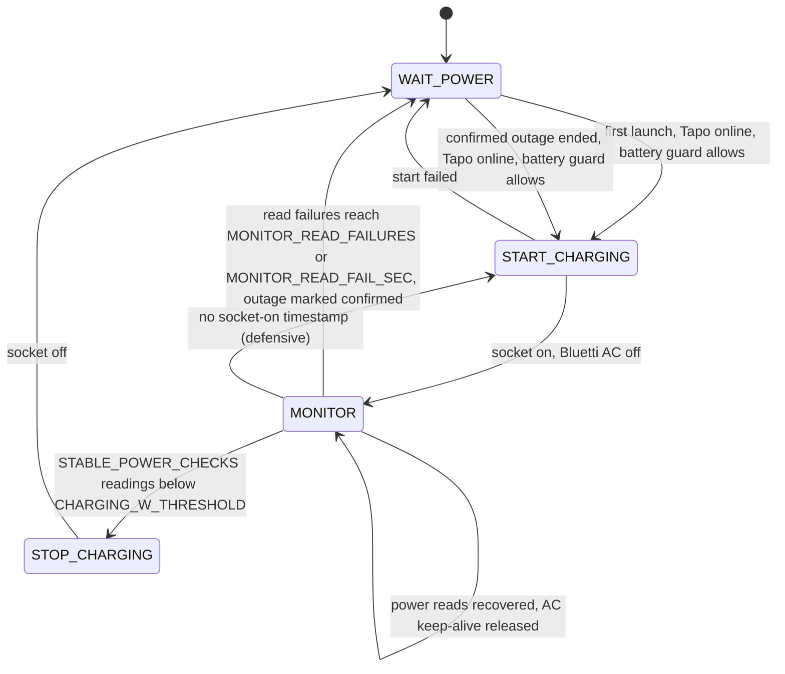
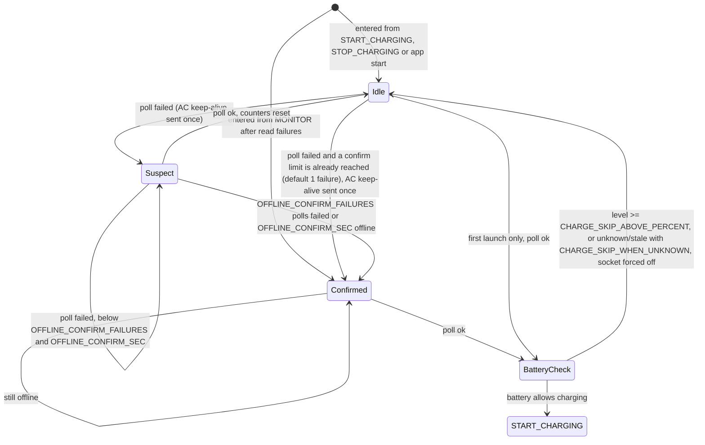

# bluettique

Bluettique is a Python-based project designed to manage and control various smart devices, including Bluetti power stations and Tapo smart plugs. The project integrates with these devices using MQTT and device APIs, providing a seamless way to automate and monitor their operations.

## Features

- **Bluetti Power Station Control**: Connects to Bluetti power stations via MQTT to monitor and control AC/DC outputs, power status, and battery levels.
- **Tapo Smart Plug Integration**: Manages Tapo smart plugs via the Tapo API, enabling remote control and status monitoring.
- **State Management**: Implements a state handler to manage the different states of the system, ensuring smooth transitions and operations.
- **Logging**: Provides detailed logging for debugging and monitoring purposes.


## Table of Contents

- Installation
- Environment Variables
- Running the Project
- Charging flow behavior
- Running with Docker Compose
- Dependencies

## Installation

1. Clone the repository:

   `git clone https://github.com/your-username/your-repo.git`

2. Navigate to the project directory:

   `cd your-repo`

3. Set up a virtual environment:

   - **Linux/macOS**:

     `python3 -m venv venv`

     `source venv/bin/activate`

   - **Windows**:

     `python -m venv venv`

     `venv\Scripts\activate`

4. Install the required dependencies:

   `pip install -r requirements.txt`

## Environment Variables

This project requires some environment variables to be set. These variables are stored in a `.env` file in the root of the project.

Create a `.env` file in the root of the project and add the following variables:

```
TAPO_USERNAME=
TAPO_PASSWORD=
TAPO_IP_ADDRESS=
CHARGING_SOCKET_DEVICE_ID=  # optional; overrides TAPO_IP_ADDRESS for the charger plug
CHARGING_W_THRESHOLD=20
CHECK_INTERVAL_SEC=900
FIRST_POWER_CHECK_DELAY_SEC=30
STARTUP_GRACE_SEC=90
STABLE_POWER_CHECKS=2
STABLE_POWER_INTERVAL_SEC=60
OFFLINE_CONFIRM_FAILURES=1
OFFLINE_CONFIRM_SEC=120
CHARGE_SKIP_ABOVE_PERCENT=98
CHARGE_SKIP_WHEN_UNKNOWN=true
BATTERY_MAX_AGE_SEC=600
BATTERY_UNKNOWN_WAIT_SEC=20
MONITOR_READ_FAILURES=3
MONITOR_READ_FAIL_SEC=120
AC_RETRY_INTERVAL_SEC=30
AC_RETRY_MAX_ATTEMPTS=10
AC_ZERO_POWER_OFF_SEC=300
POWER_OFF_MAX_ATTEMPTS=5
POWER_OFF_QUIET_SEC=60

# Read but currently unused (the recheck cycle is not reachable): LOW_POWER_CONSECUTIVE_COUNT,
# MIN_ON_TIME_SEC, RECHECK_CYCLE_ENABLED, RECHECK_OFF_SEC, RECHECK_QUICK_CHECKS, RECHECK_QUICK_INTERVAL_SEC

BLUETTI_BROKER_HOST=
BLUETTI_BROKER_INTERVAL=
BLUETTI_MAC_ADDRESS=
BLUETTI_DEVICE_NAME=
BLUETTI_BROKER_CONNECTION_TIMEOUT=
BLUETTI_BROKER_RETRIES=3
BLUETTI_BROKER_RETRY_DELAY=5
RUN_DC_TEST=false  # optional one-shot DC on/off cycle at startup

ENV='dev' # 'prod'

# Boiler nightly scheduler (independent from charging loop)
BOILER_ENABLED=false
BOILER_TAPO_EMAIL=
BOILER_TAPO_PASSWORD=
BOILER_TAPO_IP=
BOILER_WINDOW_START="00:00"
BOILER_WINDOW_END="06:00"
BOILER_TOTAL_RUN_SEC=7200
BOILER_POLL_SEC=300
BOILER_ACTIVE_W_THRESHOLD=0
BOILER_STATE_FILE=logs/boiler_logs/boiler_state.json
BOILER_LOG_FILE=logs/boiler_logs/boiler.log

# Webapp
WEBAPP_ENABLED=true
WEBAPP_PORT=8080
WEBAPP_STATUS_REFRESH_MS=2000
WEBAPP_LOGS_REFRESH_MS=2000
CONNECTION_WINDOW_MIN=5
# Dashboard toggles (e.g. "Power off after charging") persist here
SETTINGS_FILE=logs/settings.json
```

Make sure to replace the placeholders with your actual credentials and settings.

## Running the Project

1. Activate the virtual environment (if not already activated):

   - **Linux/macOS**: `source venv/bin/activate`
   
   - **Windows**: `venv\Scripts\activate`

2. Run the application:

   `python main.py`

### Boiler nightly scheduler

- When `BOILER_ENABLED=true`, a separate async scheduler runs alongside charging. It targets a dedicated TAPO socket (credentials/IP above) and guarantees the socket is ON for `BOILER_TOTAL_RUN_SEC` seconds within the daily window (`BOILER_WINDOW_START`–`BOILER_WINDOW_END`, default 00:00–06:00).
- If power is unavailable at window start, it polls every `BOILER_POLL_SEC` seconds until the socket comes online, then starts. If power drops mid-run, the countdown pauses and resumes when power returns (only the remaining seconds are run).
- An optional `BOILER_ACTIVE_W_THRESHOLD` lets you count runtime only while power draw meets/exceeds the threshold (0 means count whenever the socket is ON).
- Progress persists per night to `BOILER_STATE_FILE`; if the process restarts during the same window, it resumes the remaining seconds. Logs are written to `BOILER_LOG_FILE`.

## Charging flow behavior

- The app polls the configured Tapo P110 (`CHARGING_SOCKET_DEVICE_ID` or `TAPO_IP_ADDRESS`). Charging starts on the first launch if the plug is online, or when the plug comes back online after a confirmed outage (a power cut) — but never while the Bluetti battery guard blocks it.
- A charging supervisor monitors instantaneous power to decide whether charging is active (`power >= CHARGING_W_THRESHOLD`). Once `STABLE_POWER_CHECKS` consecutive readings are below the threshold, the socket is turned off.
- Charging never starts when the Bluetti battery is at or above `CHARGE_SKIP_ABOVE_PERCENT` (the socket is forced off instead). With `CHARGE_SKIP_WHEN_UNKNOWN=true` an unknown level, or one older than `BATTERY_MAX_AGE_SEC`, also blocks the start; after a restart it waits up to `BATTERY_UNKNOWN_WAIT_SEC` for a fresh reading first. A plug is treated as disconnected after `OFFLINE_CONFIRM_FAILURES` consecutive failed polls or `OFFLINE_CONFIRM_SEC` offline; failed power reads while charging are retried for `MONITOR_READ_FAILURES` / `MONITOR_READ_FAIL_SEC` before falling back to WAIT_POWER.
- Periodic checks are spaced by `CHECK_INTERVAL_SEC`. Stable power confirmation uses `STABLE_POWER_*`.
- All state transitions and power checks are logged for observability; failures drop back to the wait state and retry.

### State machine

Main flow (the machine starts in WAIT_POWER):



WAIT_POWER logic (one pass per `CHECK_INTERVAL_SEC`; leaving WAIT_POWER and re-entering it clears the outage state):



| State | What it does | Switches | Exits |
|---|---|---|---|
| WAIT_POWER | Polls the Tapo plug and tracks outages; runs the battery guard when a start is possible | Tapo socket: forced OFF only when the battery guard blocks a start. Bluetti AC: ON once per outage on the first failed poll | START_CHARGING (see diagram); otherwise sleeps `CHECK_INTERVAL_SEC` and stays |
| START_CHARGING | Turns the socket on and connects the Bluetti | Tapo socket ON; Bluetti AC OFF (fire-and-forget MQTT publish) | MONITOR on success; WAIT_POWER if anything raises |
| MONITOR | Waits `FIRST_POWER_CHECK_DELAY_SEC`, then reads power; retries a failed read once after re-login | No switching on success. On a failed read (after the retry): Bluetti AC ON once. When reads recover: Bluetti AC OFF | STOP_CHARGING after `STABLE_POWER_CHECKS` low readings; WAIT_POWER after repeated read failures |
| STOP_CHARGING | Resets the charging timers | Tapo socket OFF | WAIT_POWER |

Notes:
- `STARTUP_GRACE_SEC` only applies to readings at or above the threshold (the loop sleeps until the grace ends); low readings are counted from the start.
- The old recheck cycle (`RECHECK_*`, `LOW_POWER_CONSECUTIVE_COUNT`, `MIN_ON_TIME_SEC`) was never reachable and has been removed. The variables are still read for compatibility but have no effect.

#### Background AC recovery task

- **Starts** when the Bluetti AC keep-alive is sent: on the first failed Tapo poll in WAIT_POWER per outage, or on the first failed power read in MONITOR (after its retry). It polls the Bluetti status every `STABLE_POWER_INTERVAL_SEC`.
- **Retries AC ON** while the Bluetti reports AC off, the machine is in WAIT_POWER with a confirmed outage, and retries are not suppressed: at most `AC_RETRY_MAX_ATTEMPTS` times (0 or less means unlimited), at least `AC_RETRY_INTERVAL_SEC` apart.
- **Turns AC off** when AC is on but draws about 0 W for `AC_ZERO_POWER_OFF_SEC`; further retries are then suppressed until the Bluetti draws power again.
- **Is cancelled** when the machine moves to any state other than WAIT_POWER, when MONITOR power reads recover, or when a new keep-alive replaces it. It keeps running while the machine stays in WAIT_POWER, including after a single failed poll that turned out to be a blip.

## Running with Docker Compose

1. Ensure Docker and Docker Compose are installed on your system.

2. Build and start the containers in detached mode:

   `docker compose up -d --build`

3. To stop the containers:

   `docker compose down`

## Dependencies

All dependencies are listed in the `requirements.txt` file. To install them, use:

`pip install -r requirements.txt`
